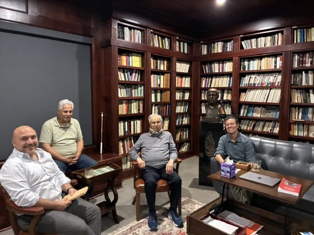

Professors Muhsin al-Musawi of Columbia University, a scholar of Arabic literature, and Tarek El-Ariss of Dartmouth College, who chairs its Middle Eastern Studies Program, visited the center and toured the libraries.

*During the visit.*
